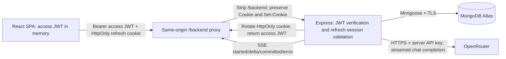

# Customer Support Agent

An AI-powered customer support chat application with persistent session management, real-time response streaming, and conversation history.

Built as an independent full-stack software product with a React single-page application, an Express TypeScript backend, MongoDB persistence, and OpenRouter AI integration.

---

## 1. Project Overview

Customer Support Agent is a conversational customer service application designed to handle customer inquiries through an interactive web interface. It combines secure authentication, resilient session persistence via rotating HttpOnly cookies, atomic conversation storage in MongoDB, and streaming AI responses powered by OpenRouter.

### Core Capabilities

- **Secure User Authentication**: Registration and login using bcrypt password hashing (cost 12) and stateless HS256 access JWTs stored strictly in application memory.
- **Persistent Sessions**: Rotating HttpOnly refresh cookies backed by hashed MongoDB session records with automatic reuse detection, CSRF protection, and multi-tab synchronization.
- **AI-Powered Customer Support**: Real-time response streaming via Server-Sent Events (SSE) from OpenRouter, conditioned by a fixed customer support system prompt and conversation history context.
- **Conversation Persistence**: Full multi-turn conversation storage in MongoDB with atomic user/assistant message pair writes, optimistic concurrency control, and deterministic titling.
- **Conversation Management**: Paginated conversation history, per-thread draft preservation, empty states, and continuation of previous chats up to bounded exchange limits.
- **Containerized & Production-Ready**: Complete Docker Compose setup with non-root containers, unprivileged Nginx reverse proxy, and zero-downtime health probing.

---

## 2. Features

- **Responsive Interface**: Mobile-friendly, accessible layout built with React, TypeScript, and Tailwind CSS.
- **Real-Time Streaming**: Incremental token delivery via SSE with typing indicators and cursor feedback during generation.
- **Atomic Chat Guarantees**: Messages are committed to the database in atomic pairs; partial or failed streams are never saved as complete exchanges.
- **Session Restoration**: Seamless session renewal across browser reloads and reopens without storing tokens in JavaScript-accessible storage (`localStorage` or `sessionStorage`).
- **CSRF & Security Hardening**: Origin validation, `X-CSRF-Protection` custom header requirements, security headers via Helmet, input sanitization, and parameterized database queries.
- **Deterministic Conversation Titling**: Automatically titles conversations based on the initial user message (shortened and normalized to 80 characters).

---

## 3. Technology Stack

### Frontend (`client/`)
- **Framework**: React 19, TypeScript (strict mode), Vite 6
- **Routing**: React Router 7
- **Styling**: Tailwind CSS 4
- **HTTP Client**: Axios with custom interceptors and fetch-based streaming adapter
- **Testing**: Vitest, React Testing Library, jsdom

### Backend (`server/`)
- **Runtime**: Node.js 24 (pinned LTS)
- **Server Framework**: Express 5 (TypeScript)
- **Database & ODM**: MongoDB Atlas, Mongoose 8
- **Authentication**: `jsonwebtoken` (HS256), `bcrypt` (cost 12)
- **AI Provider**: OpenRouter API (`https://openrouter.ai/api/v1/chat/completions`)
- **Security**: Helmet, CORS, strict origin verification, custom CSRF middleware
- **Testing**: Vitest, Supertest, Axios mock adapter

### Infrastructure & DevOps
- **Containerization**: Docker, Docker Compose (multistage builds, unprivileged Nginx reverse proxy)
- **Deployment Targets**: Vercel (frontend SPA and API proxy), Render (containerized backend service)

---

## 4. Architecture Overview

The system consists of two primary services decoupled by a same-origin reverse proxy:



For complete technical specifications, database schemas, and interface definitions, refer to [docs/ARCHITECTURE.md](docs/ARCHITECTURE.md).

---

## 5. Project Structure

```text
customer-support-agent/
├── client/                     # Frontend React application
│   ├── src/
│   │   ├── api/                # Axios client and streaming fetch adapter
│   │   ├── auth/               # AuthContext, session coordination, Route guards
│   │   ├── components/         # Chat composer, history panel, message list
│   │   ├── config/             # Environment validation and configuration
│   │   ├── pages/              # AuthPage (Login/Signup), ChatPage
│   │   └── types/              # TypeScript interface definitions
│   ├── tests/                  # Unit and component test suites
│   ├── Dockerfile              # Multistage build with unprivileged Nginx
│   ├── nginx.conf              # Reverse proxy and SPA routing config
│   ├── package.json            # customer-support-client metadata
│   └── vite.config.ts          # Vite build configuration
├── server/                     # Backend Express API
│   ├── src/
│   │   ├── config/             # Environment parsing and auth duration configuration
│   │   ├── controllers/        # Thin route controllers (auth, chat, health)
│   │   ├── database/           # Mongoose connection management
│   │   ├── errors/             # Standardized application error handling
│   │   ├── middleware/         # Auth, CSRF, error handling, rate/payload limits
│   │   ├── models/             # Mongoose schemas (User, Conversation, RefreshSession)
│   │   ├── routes/             # Express route declarations (/auth, /chat, /health)
│   │   ├── services/           # Business logic (authService, chatService, openRouter)
│   │   └── types/              # Canonical DTO and API contract definitions
│   ├── tests/                  # Unit and integration test suites
│   ├── Dockerfile              # Multistage Node.js production image
│   └── package.json            # customer-support-server metadata
├── docs/                       # Product and architecture documentation
│   ├── ARCHITECTURE.md         # Software architecture and technical contracts
│   ├── PRD.md                  # Product requirements document
│   ├── TASKS.md                # Implementation milestones and development tracker
│   └── TEST_PLAN.md            # Comprehensive testing and QA plan
├── AGENTS.md                   # Coding standards and development guidelines
├── compose.yaml                # Multi-container orchestration definition
└── README.md                   # Primary project documentation
```

---

## 6. Getting Started

### Prerequisites

- **Node.js**: `24.21.0` (pinned in `.nvmrc` and package engines; active via `nvm use 24.21.0`).
- **npm**: `11.x` (11.19.0 recommended).
- **MongoDB Atlas**: A reachable MongoDB Atlas cluster with least-privilege credentials and network access configured for your IP.
- **OpenRouter API Key**: A valid key with access to free or standard chat models (e.g., `openrouter/free`).
- **Docker Desktop**: Required for containerized execution (Compose 2.20+).

---

## 7. Environment Configuration

The client and server packages maintain independent configuration via local environment files.

### Configuration Reference

| Variable | Scope | Purpose |
|---|---|---|
| `VITE_API_BASE_URL` | Client | Same-origin proxy path (`/backend`) or absolute backend origin. |
| `BACKEND_API_URL` | Vercel | Target backend origin used by Vercel rewrites at build time. |
| `MONGODB_URI` | Server | MongoDB Atlas connection string with database name. |
| `JWT_SECRET` | Server | Cryptographically secure random signing key (minimum 32 bytes). |
| `JWT_ACCESS_EXPIRES_IN` | Server | Access token lifespan (e.g., `15m`, max `1h`). |
| `JWT_REFRESH_EXPIRES_IN` | Server | Absolute refresh session lifespan (e.g., `1d`, max `30d`). |
| `AUTH_COOKIE_MODE` | Server | `localhost` for local HTTP development; `secure` for HTTPS deployments. |
| `OPENROUTER_API_KEY` | Server | OpenRouter API authentication credential. |
| `OPENROUTER_MODEL` | Server | Target model ID (defaults to `openrouter/free`). |
| `CLIENT_ORIGINS` | Server | Comma-separated allowlist of trusted origins for CORS and CSRF verification. |
| `PORT` | Server | Backend listening port (default `5000`). |
| `NODE_ENV` | Server | Environment mode (`development`, `test`, or `production`). |
| `MONGODB_TEST_URI` | Server (test) | Dedicated test database URI (must end with `_test`). |

---

## 8. Local Development

Install dependencies for both packages:

```bash
npm --prefix client ci
npm --prefix server ci
```

### 1. Configure Environment Files

Create the local `.env` files from their respective examples:

```bash
cp client/.env.example client/.env
cp server/.env.example server/.env
```

Ensure `client/.env` contains:
```dotenv
VITE_API_BASE_URL=/backend
```

Configure `server/.env` with your MongoDB credentials, generated secret, and OpenRouter key:
```dotenv
NODE_ENV=development
PORT=5000
CLIENT_ORIGINS=http://localhost:5173,http://localhost:8080
MONGODB_URI=mongodb+srv://<username>:<password>@<cluster>.mongodb.net/customer_support
JWT_SECRET=generate-a-random-secret-of-at-least-32-bytes
OPENROUTER_API_KEY=your-openrouter-key
OPENROUTER_MODEL=openrouter/free
JWT_ACCESS_EXPIRES_IN=15m
JWT_REFRESH_EXPIRES_IN=1d
AUTH_COOKIE_MODE=localhost
```

### 2. Run the Services

Start the backend and frontend in separate terminals:

```bash
# Terminal 1: Backend API
npm --prefix server run dev

# Terminal 2: Frontend Client
npm --prefix client run dev
```

- **Frontend**: Accessible at `http://localhost:5173`
- **Backend API**: Accessible at `http://localhost:5000`
- **Readiness Probe**: `http://localhost:5000/health` (returns 200 when database and indexes are ready)

---

## 9. Running with Docker

Docker Compose deploys the complete environment locally, mirroring production topology with an unprivileged Nginx proxy and secure network boundaries.

### Initial Build & Launch

Ensure `server/.env` is configured, then run:

```bash
# Validate configuration quietly
docker compose config --quiet

# Build images and start containers in the background
docker compose up -d --build --wait --wait-timeout 60

# Check running status and health
docker compose ps
```

### Accessing the Application

- **Web Application**: `http://localhost:8080`
- **Backend Health Check**: `http://localhost:8080/backend/health` (proxied) or `http://localhost:5000/health` (direct)

### Compose Services

| Service | Container Port | Host Port | Role |
|---|---|---|---|
| `server` | 5000 | 5000 | Node.js Express API running non-root (UID 1000). |
| `client` | 8080 | 8080 | Unprivileged Nginx static file server and `/backend` reverse proxy. |

### Docker Lifecycle Commands

```bash
# View aggregated service logs
docker compose logs -f --tail=100

# Stop services
docker compose stop

# Restart containers
docker compose restart

# Tear down containers and private network (database data in Atlas is preserved)
docker compose down
```

---

## 10. Authentication and Security

### Token Lifecycle & Session Model

1. **Access Token**: Short-lived HS256 JWT (default: 15 minutes). Held strictly in React memory; never serialized to Web Storage. Sent via the `Authorization: Bearer <token>` header.
2. **Refresh Session**: Opaque 64-byte random credential stored exclusively in a host-only, HttpOnly, SameSite=Lax cookie.
3. **Database-Backed Sessions**: MongoDB stores only SHA-256 hashes of selectors and tokens (`RefreshSession` collection).
4. **Session Rotation**: Every refresh atomically invalidates the consumed credential and issues a new one. Reuse within a 10-second grace window resolves conflicts safely; later reuse triggers immediate family revocation.
5. **CSRF Defenses**: All mutation and refresh routes require exact origin verification against `CLIENT_ORIGINS` and validate the `X-CSRF-Protection: 1` header.

---

## 11. AI Streaming and Conversation Persistence

### Streaming Lifecycle (`POST /chat/send/stream`)

1. **Request Validation**: Verifies Bearer JWT, sanitizes input, and confirms ownership of any provided `conversationId`.
2. **Context Window**: Retrieves the last 10 completed exchanges from MongoDB and prepends the immutable support system prompt.
3. **SSE Connection**: Initiates an SSE stream with an initial `started` event.
4. **Delta Delivery**: Streams real-time tokens from OpenRouter as `delta` events.
5. **Atomic Commit**: Once the provider emits `[DONE]`, the complete user/assistant message pair is persisted to MongoDB in a single atomic update.
6. **Committed Event**: The server emits a `committed` event containing canonical message IDs and timestamps. The client transitions the temporary preview into permanent transcript state only after receiving this event.

---

## 12. API Overview

All routes are mounted at root (without `/api` prefixes).

| Method | Endpoint | Auth | Description |
|---|---|---|---|
| `GET` | `/health` | None | Returns database connectivity and index readiness status. |
| `POST` | `/auth/signup` | CSRF | Registers a new user; sets refresh cookie and returns initial access JWT. |
| `POST` | `/auth/login` | CSRF | Authenticates credentials; sets refresh cookie and returns access JWT. |
| `POST` | `/auth/refresh` | Cookie + CSRF | Rotates refresh credential and issues a new access JWT. |
| `POST` | `/auth/logout` | Cookie + CSRF | Revokes server session and clears the refresh cookie. |
| `POST` | `/chat/send` | Bearer JWT | Compatibility JSON endpoint for non-streamed exchanges. |
| `POST` | `/chat/send/stream` | Bearer JWT | SSE endpoint streaming real-time AI responses. |
| `GET` | `/chat/history` | Bearer JWT | Retrieves paginated conversation summaries (supports `page` and `limit`). |
| `GET` | `/chat/history?conversationId=:id` | Bearer JWT | Retrieves the complete transcript for an owned conversation. |

---

## 13. Testing

The codebase includes comprehensive unit, component, integration, and security test suites.

```bash
# Frontend checks
npm --prefix client run lint
npm --prefix client run typecheck
npm --prefix client run test -- --run
npm --prefix client run build

# Backend checks
npm --prefix server run lint
npm --prefix server run typecheck
npm --prefix server run test -- --run
npm --prefix server run build

# Database integration tests (requires MONGODB_TEST_URI)
npm --prefix server run test:integration
```

For complete test methodologies and verification matrices, refer to [docs/TEST_PLAN.md](docs/TEST_PLAN.md).

---

## 14. Deployment

### Frontend Deployment (Vercel)

1. Connect the repository to Vercel with root directory set to `client`.
2. Framework preset: **Vite**. Build command: `npm run build`. Output directory: `dist`.
3. Set environment variables:
   - `VITE_API_BASE_URL`: `/backend`
   - `BACKEND_API_URL`: `https://your-backend.onrender.com` (HTTPS origin of the deployed API)
4. Vercel utilizes `client/vercel.ts` to proxy `/backend/*` requests directly to Render while forwarding cookies and custom headers.

### Backend Deployment (Render)

1. Deploy a **Web Service** from the repository using Docker (`server/Dockerfile`).
2. Configure environment variables in the Render dashboard:
   - `NODE_ENV`: `production`
   - `AUTH_COOKIE_MODE`: `secure`
   - `CLIENT_ORIGINS`: `https://your-frontend.vercel.app`
   - `MONGODB_URI`: Atlas production connection string
   - `JWT_SECRET`: Random 32+ byte string
   - `OPENROUTER_API_KEY`: Production OpenRouter API key
   - `OPENROUTER_MODEL`: `openrouter/free`
3. Set health check path to `/health`.

---

## 15. Known Limitations

- **Stateless Token Invalidation**: Access JWTs remain valid until their expiration (up to 15 minutes) even if a refresh session is revoked.
- **Provider Quota & Cold Starts**: Free-tier models on OpenRouter may experience rate limits or model unavailability. Hosted backends on free tiers may experience cold-start latency.
- **Conversation Length Limit**: Threads are capped at 100 exchanges (200 messages) to bound MongoDB document size and context consumption.
- **Single-Origin Deployment**: Designed for same-origin proxy topologies; cross-origin cookie configurations require explicit origin allowlisting.
